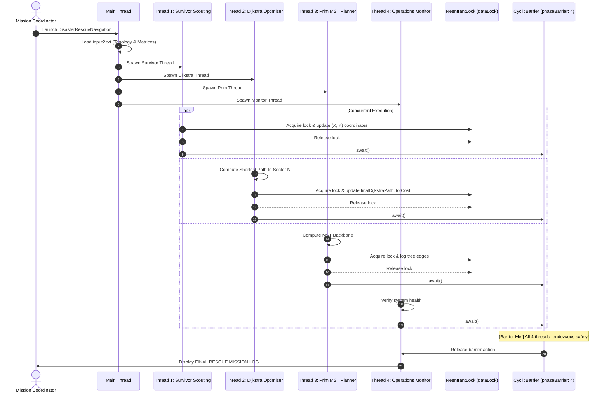

# 🚨 Disaster Rescue Navigator — Concurrent Mission Planning System

[](https://www.oracle.com/java/)
[](https://docs.oracle.com/en/java/javase/17/docs/api/java.base/java/util/concurrent/package-summary.html)
[](https://en.wikipedia.org/wiki/Dijkstra%27s_algorithm)
[](https://docs.oracle.com/javase/8/docs/api/java/util/concurrent/CyclicBarrier.html)
[](LICENSE)

> **Disaster Rescue Navigator** is a high-performance multithreaded Java application that simulates critical disaster response operations. It parallelizes target sector scouting, shortest evacuation path optimization (**Dijkstra's Algorithm**), and emergency telecommunication backbone planning (**Prim's Minimum Spanning Tree Algorithm**) using robust thread synchronization barriers (`CyclicBarrier`) and mutual exclusion locks (`ReentrantLock`).

---

## 📌 Mission Background & Engineering Problem

During natural catastrophes (floods, landslides, earthquakes), emergency operations centers face severe latency bottlenecks:
1. **Time-Critical Evacuation:** Rescue teams must traverse damaged road networks where edge weights change dynamically based on debris or flooding.
2. **Communications Infrastructure:** Field teams need an emergency mesh/cable telecommunication backbone with minimal total cable length connecting all operating sectors.
3. **Parallel Mission Orchestration:** Scouting for survivors, path planning, and infrastructure design cannot wait sequentially; they must execute concurrently without data race conditions before teams can be deployed.

**Disaster Rescue Navigator** simulates this concurrent workflow across a multi-sector disaster topology, ensuring that no rescue team is dispatched until all concurrent mission prep threads rendezvous safely at an operational synchronization barrier.

---

## 🧵 Multithreaded Architecture & Synchronization

The system employs a 4-worker thread architecture with two primary concurrency primitives from `java.util.concurrent`:



### Concurrency Primitives Used:
* **`CyclicBarrier phaseBarrier = new CyclicBarrier(4, barrierAction)`:** Enforces a strict checkpoint. All 4 threads must complete their mathematical and scouting calculations before the mission monitor displays the final dispatch log.
* **`ReentrantLock dataLock = new ReentrantLock()`:** Guarantees thread-safe mutual exclusion when modifying shared global memory variables (`humanLocX`, `humanLocY`, `totEvacuationCost`, `finalDijkstraPath`).

---

## 🧮 Algorithmic Specifications

### 1. Dijkstra's Algorithm (Single-Source Shortest Path)
* **Goal:** Computes the fastest route from Base Camp (Sector `0`) to the destination sector (`totLoc - 1`).
* **Time Complexity:** $\mathcal{O}(V^2)$ on adjacency matrix representation.
* **Path Reconstruction:** Uses a `parent[]` pointer array to reconstruct the exact traversal sequence (e.g., `[0 -> 2 -> 1 -> 4]`) rather than only returning the scalar minimum cost.

### 2. Prim's Algorithm (Minimum Spanning Tree - MST)
* **Goal:** Connects all sectors into a survivable telecommunications network with the lowest total cable deployment cost.
* **Time Complexity:** $\mathcal{O}(V^2)$ on dense matrix.
* **Output:** Logs each deployed edge link with exact distance weights and outputs the total spanning tree weight.

---

## 📄 Input Data Specification (`input2.txt`)

The application dynamically reads its operating parameters from [`input2.txt`](input2.txt), allowing mission parameters to be adjusted without recompilation:

```text
# Maximum boundaries for scanning survivor location coordinates 
500

# Evacuation Routes Travel Time Matrix (in minutes)
# Defines bidirectional travel times between Base Camp (Sector 0) and surrounding Sectors.
0 4 2 8 0
4 0 1 5 6
2 1 0 8 9
8 5 8 0 2
0 6 9 2 0

# Emergency Communication Network Cable Weight Matrix (in kilometers)
# Defines distance costs to deploy a physical, stable network backbone connecting all sectors.
0 9 12 6 0
9 0 3 7 5
12 3 0 11 7
6 7 11 0 8
0 5 7 8 0
```

---

## 🖥️ Sample Execution Output

```text
+=== Starting Disaster Rescue Navigation System ===+
[System Info] Input datasets successfully loaded from 'input2.txt'.

[Thread 1] Scanning disaster area for missing humans...
[Thread 3] Running Prim Network Backbone Planner...
[Thread 2] Running Dijkstra Route Optimization...
[Thread 4] Operations dashboard initiated. Monitoring workers...
[Thread 3] Prim established stable communication backbone edges:
    -> Edge Link: Location 3 === (Weight: 7) === Location 1
    -> Edge Link: Location 1 === (Weight: 3) === Location 2
    -> Edge Link: Location 0 === (Weight: 6) === Location 3
    -> Edge Link: Location 1 === (Weight: 5) === Location 4
[Thread 3] Total network spanning tree backbone path weight: 21
[Thread 1] Found survivor group location at coordinates: (375, 374)
[Thread 2] Dijkstra Route Calculated -> Path Sequence: [0 -> 2 -> 1 -> 4] (Cost: 9 mins)

[Barrier Met] All rescue preparation threads finished calculations safely.

=== FINAL RESCUE MISSION LOG ===
Target Coordinates     : (375, 374)
Optimal Route Sequence : [0 -> 2 -> 1 -> 4]
Total Travel Time      : 9 minutes
Status                 : Evacuation route clear. Dispatching teams immediately!
=================================
```

---

## 📂 Project Directory Structure

```text
Disaster_Rescue_Navigator/
├── DisasterRescueNavigation.java  # Multithreaded concurrent simulation and algorithms
├── input2.txt                     # Sector coordinate bounds & graph adjacency matrices
├── README.md                      # System documentation and algorithmic analysis
└── .gitignore                     # Ignores compiled .class binaries and IDE artifacts
```

---

## 🛠️ Compilation & Execution Guide

### 1. Prerequisites
* **Java Development Kit (JDK):** Version 11, 17, or 21 (`javac -version`).

### 2. Clone the Repository
```bash
git clone https://github.com/akhmal02/Disaster_Rescue_Navigator.git
cd Disaster_Rescue_Navigator
```

### 3. Compile the Java Source Code
```bash
javac DisasterRescueNavigation.java
```

### 4. Run the Application
```bash
java DisasterRescueNavigation
```

---

## 👨‍💻 Author & Academic Attribution
* **Developer:** Muhammad Akhmal bin Mohamad Hussin ([@akhmal02](https://github.com/akhmal02))
* **Institution:** Universiti Teknologi MARA (UiTM)
* **Faculty:** College of Computing, Informatics and Mathematics
* **Course:** Concurrent & Parallel Programming / Advanced Algorithms
